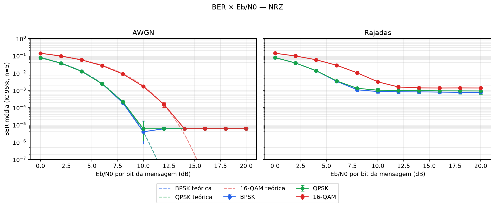
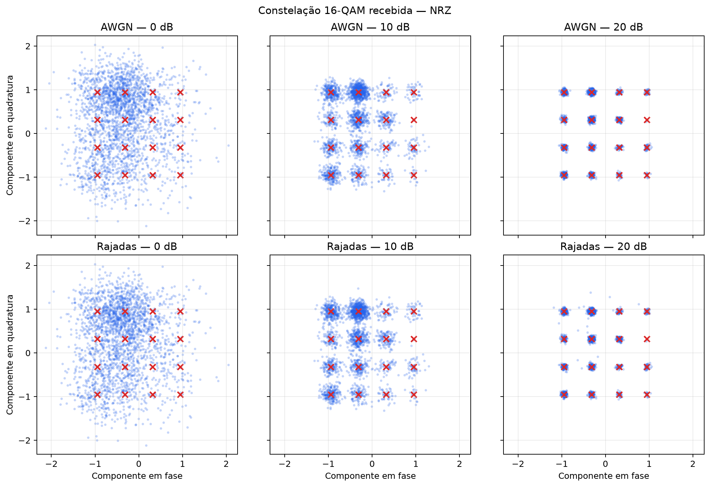

# Simulador de transmissão digital — Redes de Computadores (GB)

[](https://github.com/henriquemircofreitas/trabalho-redes-gb/actions/workflows/tests.yml)

Simulador ponta a ponta e reproduzível de um enlace digital:

`ASCII → bits → código de linha → modulação → canal → demodulação → decodificação → BER`

O projeto compara três códigos de linha (NRZ, Manchester e Manchester diferencial), três
modulações (BPSK, QPSK e 16-QAM) e dois cenários de canal (AWGN e AWGN com ruído em rajadas).
Foram executados 990 ensaios, cada um com 100.264 bits.

## Instalação

Requer [uv](https://docs.astral.sh/uv/) e não depende de serviços externos durante os experimentos.

```bash
uv sync --frozen
uv run pytest -q
```

O projeto usa Python 3.12, NumPy, Matplotlib e pytest. As versões estão fixadas em `uv.lock`.

## Execução e reprodução

```bash
# Demonstra recuperação ideal, BER a 20 dB e índices dos bits incorretos
uv run python experiments/demo.py

# Executa 990 ensaios e recria results/raw.csv e results/run_info.json
uv run python experiments/run_sweep.py

# Recria curvas BER, intervalos de confiança e tabela de compromisso
uv run python experiments/make_plots.py

# Recria os diagramas de constelação opcionais
uv run python experiments/make_constellations.py
```

Os scripts devem ser executados na raiz do repositório. `run_sweep.py` registra o commit, o estado
do Git, um hash da implementação, parâmetros, sementes e quantidade de bits.

## Arquitetura

| Etapa | Arquivo | Responsabilidade |
|---|---|---|
| Fonte | `src/sim/source.py` | ASCII ⇄ bits, MSB primeiro |
| Código de linha | `src/sim/line_codes.py` | NRZ, Manchester e Manchester diferencial |
| Modulação | `src/sim/modulation.py` | BPSK, QPSK e 16-QAM Gray, energia unitária |
| Canal | `src/sim/channel.py` | AWGN e Gilbert–Elliott com ruído adicional |
| Enlace | `src/sim/link.py` | Transmissão ponta a ponta, BER e localização dos erros |
| Experimentos | `experiments/` | Varredura, gráficos, tabela e demonstração |
| Testes | `tests/` | Testes unitários, estatísticos e ponta a ponta |

O contrato detalhado está em `docs/interface.md`; justificativas de projeto estão em
`docs/decisions.md`.

## Código de linha não é correção de erros

Código de linha define como bits são representados no sinal para controlar transições, sincronismo
e conteúdo DC. Manchester, por exemplo, transforma cada bit em dois chips e garante uma transição
no meio do bit. Pares inválidos (`00` e `11`) permitem **detectar** algumas violações, mas não
contêm informação suficiente para corrigir o bit com certeza.

Um código de correção de erros acrescenta redundância algébrica especificamente para localizar e
corrigir erros no receptor. Este trabalho não implementa FEC: mede os erros após a decodificação de
linha, conforme solicitado.

## Parâmetros experimentais

| Parâmetro | Valor |
|---|---|
| Mensagem | 12.533 caracteres ASCII de *Dom Casmurro* |
| Bits por transmissão | 100.264 |
| Eb/N0 | 0, 2, 4, ..., 20 dB (11 valores) |
| Repetições | 5 sementes: 0, 1, 2, 3 e 4 |
| Combinações | 3 códigos × 3 modulações × 2 canais |
| Total | 990 transmissões; 99.261.360 bits de mensagem |
| Canal de rajadas | 1% em estado ruim; rajada média de 20 símbolos; ruído ruim equivalente a 0 dB |
| Variabilidade | média e IC de 95% de Student, `t=2,776`, `n=5` |
| Zero erros | limite superior de 95% pela regra de três |

Eb/N0 é definido por bit da mensagem. O canal mede a energia média do fluxo transmitido antes de
dimensionar o ruído, evitando viés porque os bits do texto ASCII não são equiprováveis.

## Resultados principais

- Em canal ideal, as nove combinações recuperaram os 100.264 bits e o texto exatamente.
- Em AWGN a 20 dB, todas as combinações tiveram zero erros nas cinco repetições.
- NRZ-BPSK atingiu BER média `3,99×10⁻⁶` a 10 dB; NRZ-16-QAM ficou em `1,67×10⁻³`.
- Sob rajadas, aumentar Eb/N0 não remove o ruído adicional: em 20 dB, a BER média variou de
  `7,72×10⁻⁴` (NRZ-BPSK) a `3,77×10⁻³` (Manchester diferencial + 16-QAM).
- Para BER `10⁻³` em AWGN, NRZ-BPSK exigiu aproximadamente 6,69 dB, enquanto NRZ-16-QAM
  exigiu 10,43 dB, trocando potência por quatro vezes a eficiência espectral.
- Manchester custa metade da eficiência espectral e aproximadamente 3 dB no receptor de decisão
  abrupta usado aqui. Manchester diferencial também propaga determinados erros entre bits.

### Curvas de BER para NRZ



### Constelações 16-QAM recebidas



Resultados e análise completa:

- `results/raw.csv`: todas as 990 observações individuais.
- `results/run_info.json`: configuração e proveniência.
- `results/tradeoff.md`: tabela BER × eficiência espectral.
- `results/plots/ber_nrz.png`, `ber_manchester.png` e `ber_diff_manchester.png`.
- `results/plots/comparacao_canais_nrz.png`.
- `results/plots/constelacoes_16qam.png`.
- `docs/relatorio.md`: interpretação, limitações e conclusões.

## Eficiência espectral nominal

Assumindo pulsos de Nyquist ideais e largura de banda igual à taxa de símbolos:

| Código | BPSK | QPSK | 16-QAM |
|---|---:|---:|---:|
| NRZ | 1 bit/s/Hz | 2 bits/s/Hz | 4 bits/s/Hz |
| Manchester | 0,5 bit/s/Hz | 1 bit/s/Hz | 2 bits/s/Hz |
| Manchester diferencial | 0,5 bit/s/Hz | 1 bit/s/Hz | 2 bits/s/Hz |

## Divisão de responsabilidades

A implementação foi dividida por blocos para que cada integrante pudesse desenvolver e apresentar
uma parte completa do sistema.

| Integrante | Responsabilidade |
|---|---|
| Bernardo Dauber | Fonte, códigos de linha, modulações, enlace, testes e demonstração |
| Henrique Freitas | Canais, execução experimental, gráficos, análise e tabela |
| Ambos | README, revisão dos resultados, vídeo e apresentação |

## Vídeo e apresentação

Materiais prontos para a apresentação:

- [`docs/apresentacao_redes_gb.pptx`](docs/apresentacao_redes_gb.pptx): PowerPoint com 11 slides e notas de fala.
- [`docs/apresentacao_redes_gb.pdf`](docs/apresentacao_redes_gb.pdf): versão de segurança para apresentação.
- [`docs/roteiro_apresentacao.md`](docs/roteiro_apresentacao.md): divisão de tempo e perguntas prováveis.
- [`docs/roteiro_video.md`](docs/roteiro_video.md): roteiro do vídeo de até cinco minutos.

Os slides podem ser recriados com `uv run python scripts/make_slides.py`; as figuras são lidas
diretamente de `results/plots/`.

O link do vídeo será incluído aqui depois da gravação final, com a participação dos dois
integrantes e duração máxima de cinco minutos.

## Limitações

- O receptor usa decisões abruptas; não explora informação de confiabilidade.
- Não há sincronização, estimação de canal, filtragem de pulso ou FEC.
- Os intervalos usam apenas cinco repetições, mínimo exigido; em BER muito baixa, o limite da regra
  de três é mais informativo que um intervalo t.
- O processo de rajadas avança por símbolo; portanto uma rajada afeta quantidades diferentes de
  chips conforme a ordem da modulação. Essa escolha está documentada e é parte da comparação.

## Mensagem transmitida

`data/source.txt` é um trecho em domínio público de *Dom Casmurro*, transliterado para ASCII. O
script `scripts/make_source_txt.py` documenta sua geração; o experimento não precisa baixá-lo.
